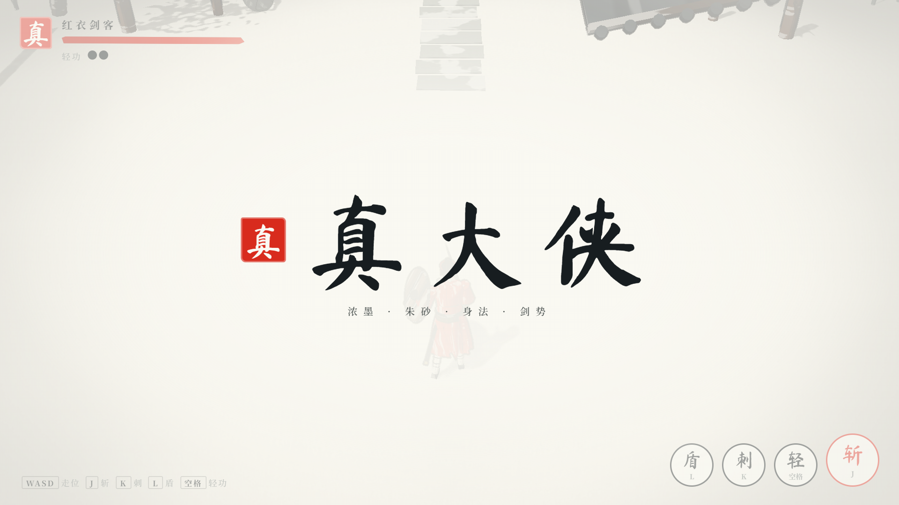
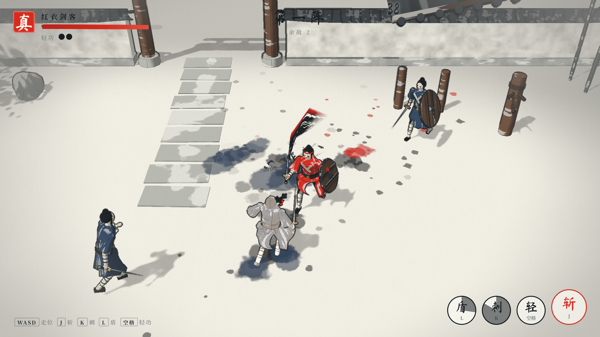

# 真大侠 · 原型 (True Hero Prototype)

> **浓墨 · 朱砂 · 身法 · 剑势**  
> 一个零构建、零外部三维资产、单文件即开即玩的 **水墨武侠 3D 动作原型**（基于 WebGL2 / Three.js 与自定义宣纸飞白水墨着色器）。





---

## 项目简介 | Overview

**《真大侠 · 原型》（True Hero Prototype）** 是一个浓缩在单个 `index.html` 文件中的 3D 水墨武侠动作游戏技术与玩法切片。项目不依赖任何外部模型贴图或打包工具链——庭院建筑、牌坊竹林、19 骨骼蒙皮剑客、衣摆玉佩布料解算、飞白剑光与宣纸水墨描边全部由代码与 GLSL 着色器程序化实时生成。

**True Hero Prototype** is a zero-build, single-file 3D ink-wash Wuxia action prototype built on WebGL2 and Three.js. Every character mesh, 19-bone skeletal rig, Verlet cloth simulation, courtyard prop, dry-brush (*feibai*) blade trail, and Xuan-paper ink-outline post-process pass is procedurally generated at runtime with zero external 3D assets.

---

## 快速体验 | Quick Start

### 方式一：本地直接打开（零依赖）
克隆或下载本仓库后，使用任意支持 WebGL2 的现代浏览器（Chrome / Edge / Firefox / Safari）直接双击打开 `index.html`：

```bash
git clone https://github.com/xiuN1ng/true-hero-prototype.git
cd true-hero-prototype
# 直接双击 index.html，或使用任意静态服务器启动：
npx serve .
```

### 方式二：调试与自动演示参数（URL Query Params）
在地址栏后追加参数可解锁内置模式：

| 参数 | 说明 | 示例 |
| :--- | :--- | :--- |
| `?demo` | **自动演武模式**：内置 AI 自动走位、破盾、轻功闪避与择取功法 | `index.html?demo` |
| `?seed=<number>` | **固定随机种子**：保证波次刷新与随机行为可复现（默认 `7`） | `index.html?seed=42` |
| `?fixed` | **锁定原生分辨率**：关闭帧率自适应缩放，固定 `1.0x` 渲染比例 | `index.html?fixed` |
| `?capture` | **逐帧受控模式**：禁用过渡动画，可通过控制台 `window.__th.frame(sec)` 精确推进帧 | `index.html?capture&seed=7` |

---

## 操作与招式 | Controls

| 按键 / 鼠标 | 招式 | 机制说明 |
| :--- | :--- | :--- |
| `W` `A` `S` `D` / 方向键 | **走位** | 庭院内自由移动与朝向调整 |
| `J` / 鼠标左键 | **斩** | 二段连斩（`slashA` → `slashB`），广角横扫，但正面斩击持盾敌兵会被格挡（弹出金字 **「格」**） |
| `K` / 鼠标右键 | **刺** | 垫步突刺（冷却 `1.3s`），高伤害、高硬直穿透 |
| `L` | **盾** | 盾击破防（冷却 `1.8s`），大击退并震晕持盾敌兵，瓦解正面防御 |
| `Space` / `Left Shift` | **轻功** | 腾空踏墨位移（带无敌帧与水墨残影，消耗轻功点并随时间回气） |
| `1` `2` `3` / 鼠标点击 | **择功法** | 每破一阵后调息回气，从三门武学功法中择一精进 |

---

## 阵法与武学成长 | Waves & Upgrades

### 三阵试剑
1. **第一阵 · 庭院试剑**：刀客与持盾兵混编初探，熟悉斩刺节奏与破盾博弈。
2. **第二阵 · 盾阵压境**：双盾夹击配合斗笠长刀精锐进场，考验身法拉扯与破防时机。
3. **第三阵 · 斗笠客**：双斗笠长刀精锐领衔围攻（大范围蓄力横扫 + 霸体抗打断）。

### 三门功法
- **一 · 剑势精进**：横斩伤害提升五成，剑光加宽并生出双层分枝浓墨笔锋。
- **二 · 身法进阶**：轻功储备上限 +1，腾挪留下朱砂残影与地上墨痕，掠过之敌皆受创伤。
- **三 · 招式变化**：突刺收势时斩出一道贯通敌阵的**朱砂剑气**。

---

## 核心技术亮点 | Technical Highlights

1. **物体空间「飞白」与两阶水墨着色（Surface Ink & Dry-Brush Shader）**
   - 基于 `MeshLambertMaterial.onBeforeCompile` 注入自定义着色逻辑：受光面保留明快色块，背光面压向浓墨，形成干净利落的两阶国画明暗。
   - **不游移的飞白笔触**：利用蒙皮前物体坐标（`vObj`）与布料静止坐标（`aRest`）采样三维 FBM 噪声生成干笔飞白，使笔触牢牢附着于衣袍与器物表面，角色翻腾挥剑时绝不产生屏幕空间“贴图滑动感”。
2. **预烘焙宣纸纹理与后处理笔锋描边（Xuan-Paper & Ink Edge Pass）**
   - 启动时一次性预烘焙 `512×512` 四通道 FBM 宣纸噪声图（纸纹、长纤维、笔锋粗细、断笔飞白），运行时逐像素仅做轻量贴图采样。
   - 结合**线性深度相对跳变（外轮廓）**与**窗口深度二阶差分斜率比（内折痕）**提取墨线，并由纸面空间噪声调制粗细与断续，辅以远景水墨雾气与自适应分辨率（`0.6x–1.0x` EMA 稳帧）。
3. **纯程序化骨骼蒙皮与 Verlet 布料物理**
   - 运行时构建 19 骨骼人形 `SkinnedMesh`，支持待机呼吸、跑步相位混合、四元数关键帧动作插值、根运动（Root Motion）推进与双脚贴地修正。
   - 独立 Verlet 约束布料解算器驱动四片下摆、朱砂抹额飘带、腰带与腰间玉佩链，并与腿部/胯部球体碰撞体实时交互。
4. **书法笔意战斗特效**
   - 剑轨网格模拟毛笔「起笔重、收笔细、笔尾与刃根丝状飞白」；配合 `InstancedMesh` 墨滴飞溅、落地晕染墨迹（Decal）与轻功蒙皮残影池。

---

## 开源许可 | License

本项目基于 [MIT License](./LICENSE) 开源，提交与维护作者：**coldmountainlab**。  
单文件内打包集成了 [Three.js](https://threejs.org/)（r180，MIT License）。字体通过 Google Fonts 加载（*Ma Shan Zheng*、*Noto Serif SC*，离线环境下自动回退系统楷体/宋体）。
